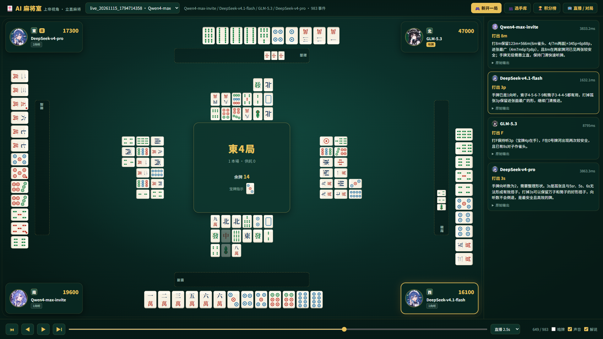
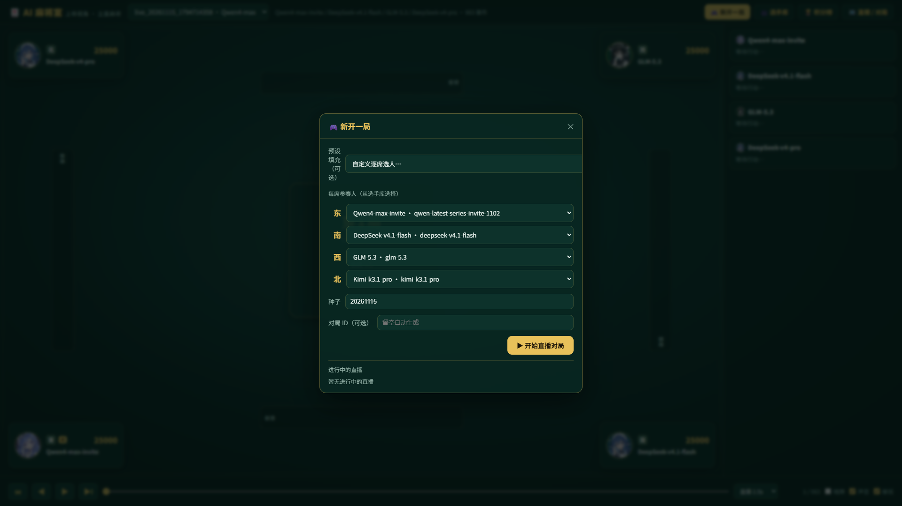
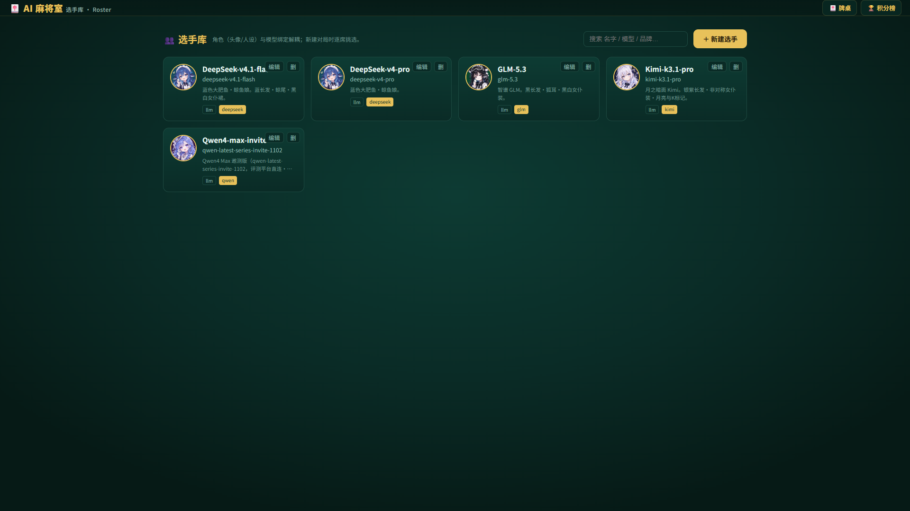
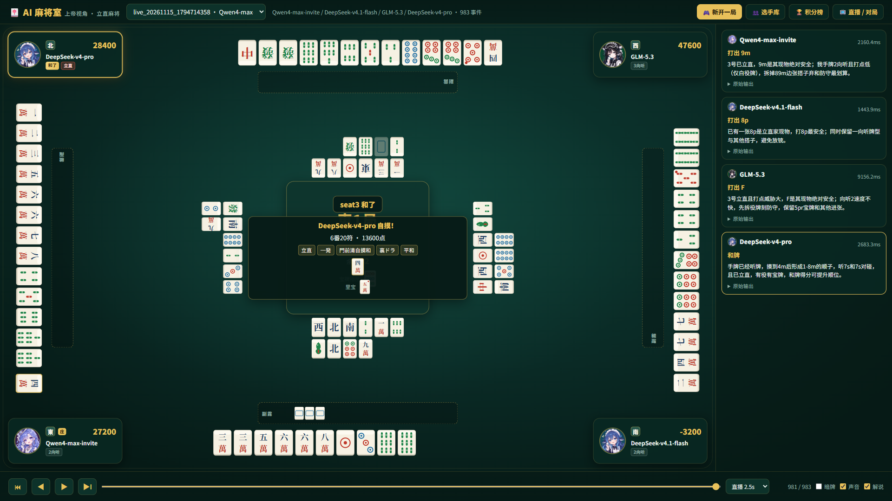
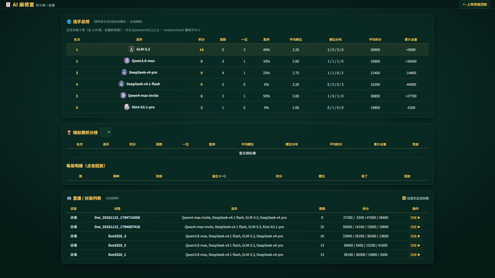

# AI 麻将室 · AI Mahjong Room

[](LICENSE)
[](https://www.python.org/)

让多个**不同大模型**作为公平玩家，同桌打**日本立直麻将**；支持**上帝视角**观看四家明牌与每步思考，可办**锦标赛**、可**直播 / 录制**成一档趣味 AI 竞技节目。

> 北极星：一个「能一起玩牌 + 可展示 + 可直播」的项目。打几场锦标赛、做几期节目即可，不追求统计学意义的上千局胜率。



---

## 它是什么

- **裁判引擎**：[RiichiEnv](https://github.com/smly/RiichiEnv)（Apache-2.0，Rust 核心）。完整立直规则（吃/碰/杠/立直/和/振听/宝牌/流局…），**每席观察由引擎强制隔离**——Agent 物理上拿不到他家手牌，只能看到自己的牌 + 场上明牌（牌河/副露/宝牌指示）。
- **协议**：[MJAI](https://github.com/Cryolite/mjai) 事件流。整局落成 `game.mjai.jsonl`（上帝视角全量）+ `decisions.jsonl`（每席动作 + 理由 + 延迟 + 兜底标记），**一份数据同时服务公平审计、回放、统计、直播、视频**。
- **玩家**：每席一个 `Agent`。`LLMAgent` 走 OpenAI 兼容 HTTP（任意模型），从引擎给出的**合法动作菜单**里选，输出 `{action_index, reason}`；解析失败/超时自动回退合法动作并记录。也支持 `random` / `mock`。
- **展示**：零依赖静态 Web 上帝视角回放器（自绘 **CC0** SVG 牌，无外部素材），四家明牌 + 牌河 + 副露 + 宝牌 + 分数 + **逐席推理面板** + 时间线 + 自动播放直播模式 + 解说字幕/音频。
- **锦标赛**：同种子**座位轮换复式**，几局~几十局，顺位点/积分排行榜（Web 积分榜 + 每局回放链接）。
- **节目**：facts-first 中文解说（edge-tts 配音 + SRT 字幕）、Playwright 无人值守录制、OBS Browser Source 直播。详见 [节目制作手册](docs/节目制作手册.md)。

## 架构

```
config/agents*.json ──► build_agents ──► [Agent×4]
                                            │ act(SeatObservation)→Action
   RiichiEnv(裁判, seed) ◄── Room 对局循环 ──┘
        │ 每席 masked 观察 + 合法动作菜单
        ▼
   game.mjai.jsonl + decisions.jsonl + summary.json   ← 唯一真相源
        │                         │
   replay.py(纯逻辑)         tournament.py(复式+积分)
        ▼                         ▼
   web/ 上帝视角回放器        leaderboard.html 积分榜
        ▼
   autoplay 直播模式 ──► OBS Browser Source ──► RTMP(B站/Twitch)
        └─► record_game.py(Playwright) ──► WebM 样片
   commentary.py + make_commentary.py(edge-tts) ──► 解说 MP3/SRT
```

## 快速开始

```powershell
# 1) 环境（Python 3.10+；已验证 3.13）
python -m venv .venv
.\.venv\Scripts\python.exe -m pip install -r server\requirements.txt
.\.venv\Scripts\python.exe -m playwright install ffmpeg   # 录制用

# 2) 密钥（从本机凭证提取到 .env，gitignore；或手动复制 .env.example 填 key）
.\.venv\Scripts\python.exe scripts\setup_env.py

# 3) 跑一局（mock 无需 key；real 需 .env）
.\.venv\Scripts\python.exe server\run_game.py --config config\agents.mock.json --seed 42
.\.venv\Scripts\python.exe server\run_game.py --config config\agents.real.json --seed 42

# 4) 上帝视角回放（浏览器打开 http://127.0.0.1:18765）
.\.venv\Scripts\python.exe server\serve_viewer.py --port 18765

# 5) 锦标赛 + 积分榜（http://127.0.0.1:18765/leaderboard.html）
.\.venv\Scripts\python.exe server\run_tournament.py --config config\tournament.random.json --out runs\cup

# 6) 解说 + 录制（详见手册）
.\.venv\Scripts\python.exe scripts\make_commentary.py --game <game_id> --tts
.\.venv\Scripts\python.exe scripts\record_game.py --game <game_id> --pace 700

# 7) 一键节目产物：自动选最精彩局→解说+复盘+积分榜（--record 再录高光样片）
.\.venv\Scripts\python.exe scripts\make_show.py --tournament runs\cup --record

# 8) 实时直播（边打边看+实时思考；对局跑在 viewer 进程内）
.\.venv\Scripts\python.exe scripts\start_live.py --config config\agents.real.json --seed 7
#    打印 watch URL：http://127.0.0.1:18765/?live=<id>
```

直播模式 URL：
- 回放带解说：`http://127.0.0.1:18765/?game=<id>&autoplay=1&pace=2500&hide=1`（OBS Browser Source 1920×1080）。
- 实时边打边看：`http://127.0.0.1:18765/?live=<id>`（🔴LIVE 顶栏+自动跟随最新+实时推理面板）。

## 交互界面（人类 / AI）

**人类（Web GUI）**：打开 `http://127.0.0.1:18765`。



- **🎮新开一局**（顶栏按钮）→ 模态：**逐席选人**（东/南/西/北 四个下拉，从选手库挑任意角色/模型），或选一个预设阵容一键填充后再微调；填 seed/局 id → 「开始直播」即发起一局实时对局并自动切到直播视图；模态内还列出当前进行中的局可一键加入观看。
- **👥选手库**（`/roster.html`）：角色管理 CRUD——新建/编辑/删除选手（显示名/类型/模型/base_url/密钥环境变量/头像/人设/temperature/timeout/高级参数/启用），角色形象与模型绑定解耦。当前内置 5 名真实模型选手：**Qwen4-max-invite / DeepSeek-v4.1-flash / DeepSeek-v4-pro / GLM-5.3 / Kimi-k3.1-pro**，可任意增删与逐席组合。



- **回放/直播**：选局、播放/暂停/单步/scrub/倍速、暗牌模式、解说开关、声音开关；`?game=<id>` 回放、`?live=<id>` 直播、`&autoplay=1&hide=1` 供 OBS。和了时弹出结算块（役种 + 番符 + 点数 + 里宝）。



- **积分榜**（`/leaderboard.html`）：选手总榜（跨正式局自动聚合）+ 锦标赛榜 + 每局明细（点击回放）+ 直播/对局列表（进行中局「🔴观看直播」）。



**AI（CLI / HTTP / Skill）**：见 [skills/ai-mahjong-room/SKILL.md](skills/ai-mahjong-room/SKILL.md)。
- 统一 CLI `scripts/room.py`（`--json` 机器可读）：`configs`（可用阵容）/`roster`（选手库）/`roster-del`/`new`（发起直播局，`--seats id1,id2,id3,id4` 逐席选人，`--offline` 离线跑）/`list`/`state`/`watch`（拿观看 URL）/`standings`/`games`/`tournament`/`show`/`recap`/`commentary`/`record`。解说员/主持人 Agent 用它掌控与了解局面。
- HTTP API：`/api/configs` `/api/roster`(GET/POST) `/api/roster/<id>`(PUT/DELETE) `/api/live/start`(POST，支持 `seats` 逐席 roster id) `/api/live/list` `/api/live/state` `/api/games` `/api/game/<id>/frames` `/api/standings` `/api/profiles` `/api/tournaments`。
- **Skill**：`skills/ai-mahjong-room/` 为 Agent Skills 格式，任何支持 skill 的 Agent 载入后即知道如何开局/观局/解说/出节目，无需读源码。

## 测试

一键回归轮（16 项：底座确定性/公平/计分、兜底鲁棒、回放守恒、锦标赛轮换复式、役种对账、听牌徽章、实时流、验收、UI 运行时、总榜/档案、AI CLI、人类新对局交互、选手库 CRUD+逐席选人）：

```powershell
.\.venv\Scripts\python.exe scripts\run_tests.py          # 全量
.\.venv\Scripts\python.exe scripts\run_tests.py --fast   # 跳过慢项
```

- 产生 artifact 的探针写临时目录，`runs/` 只保留真实对局；回放/役种探针用 `server/probes/fixtures/` 固定样本。
- UI 运行时 / 总榜 / AI CLI 三项依赖 viewer server（:18765），未启动时自动 SKIP；`p14_ui`/`p15` 自带隔离 temp server，无需外部服务。
- 最近一轮：**16 PASS / 0 FAIL / 0 SKIP**。

## 目录

```
server/aimahjong/   核心：obs/prompt/agents/room/replay/tournament/commentary/config
server/             run_game.py · run_tournament.py · serve_viewer.py
server/probes/      技术探针 + fixtures/（固定回放样本）
web/                上帝视角回放器 + 积分榜 + 选手库（零依赖，CC0 自绘牌）+ avatars/
config/             agents.*.json · tournament.*.json · roster.json（选手源）· profiles.json（头像档案）
scripts/            run_tests · room(AI CLI) · setup_env · make_commentary · make_recap · make_show · record_game · mux_commentary · build_avatars · build_roster · start_live
skills/             ai-mahjong-room/SKILL.md（Agent 用技能：开局/观局/解说/出节目）
docs/               节目制作手册.md · screenshots/
```

## 关键设计决策

| 决策 | 选择 | 理由 |
|---|---|---|
| 裁判 | RiichiEnv | Apache-2.0、每席观察内建公平、合法动作枚举、Windows wheel、可复现种子 |
| 协议 | MJAI 事件流 | in-game/replay 双模式，一份数据多用 |
| 公平 | 引擎强制 + 合法菜单 | 不靠 prompt 自觉；非法/超时回退合法并记账 |
| 显示 | 自建零依赖 Web | 直接消费 JSONL，CC0 自绘牌，OBS 就绪 |
| 推理展示 | facts-first | 引擎给可核实事实 + LLM 写散文，避免幻觉 |
| 锦标赛 | 轻量复式 | 同种子换座位，几局~几十局，节目导向非统计显著 |

## 合规

- 牌面**自绘 CC0**，无第三方版权素材；直播无需替换美术。
- **角色头像**基于社区公认 AI 娘形象二创，覆盖 **15 个品牌**（DeepSeek/千问/Kimi/智谱/GPT/Claude/Gemini/Grok/Seed/MiniMax/Llama/Mistral/Perplexity/文心/JEV；见 `config/profiles.json` 的 credit/source/license）。**DeepSeek 娘原案 CC BY-NC-SA 4.0（非商业+署名+相同方式共享）**；其余许可以原帖为准。**商业/收益直播请改用 `web/avatars/orig_*` 原创应援形象或取得作者授权**（profiles 已标 `commercial_fallback`）。
- **不接入官方雀魂/天鳳服务器**（避开 ToS/封号/版权）；纯本地自对弈。
- **严禁赌博**：仅 AI 竞技展示，无真实货币/下注。
- 密钥仅在 `.env`（gitignore），不入库、不打印。

## 文档

- [节目制作手册](docs/节目制作手册.md) — 从跑对局到出片（直播 / 录制 / 解说 / 复盘）的完整流程。
- [Agent Skill](skills/ai-mahjong-room/SKILL.md) — 让支持 skill 的 Agent 直接开局 / 观局 / 解说 / 出节目。

---

## 许可（License）

- **本项目代码**：[Apache License 2.0](LICENSE)（与裁判引擎 RiichiEnv 同许可）。
- **第三方素材**：牌面自绘 **CC0**；角色头像为社区公认 AI 娘二创，各自许可（DeepSeek 娘原案 **CC BY-NC-SA 4.0** 等）见 `config/profiles.json` 与[合规](#合规)节——**商业 / 收益直播须改用 `web/avatars/orig_*` 原创应援形象或取得作者授权**。
- **依赖**：RiichiEnv（Apache-2.0）、MJAI 协议、edge-tts、Playwright 等，各自许可以上游为准。